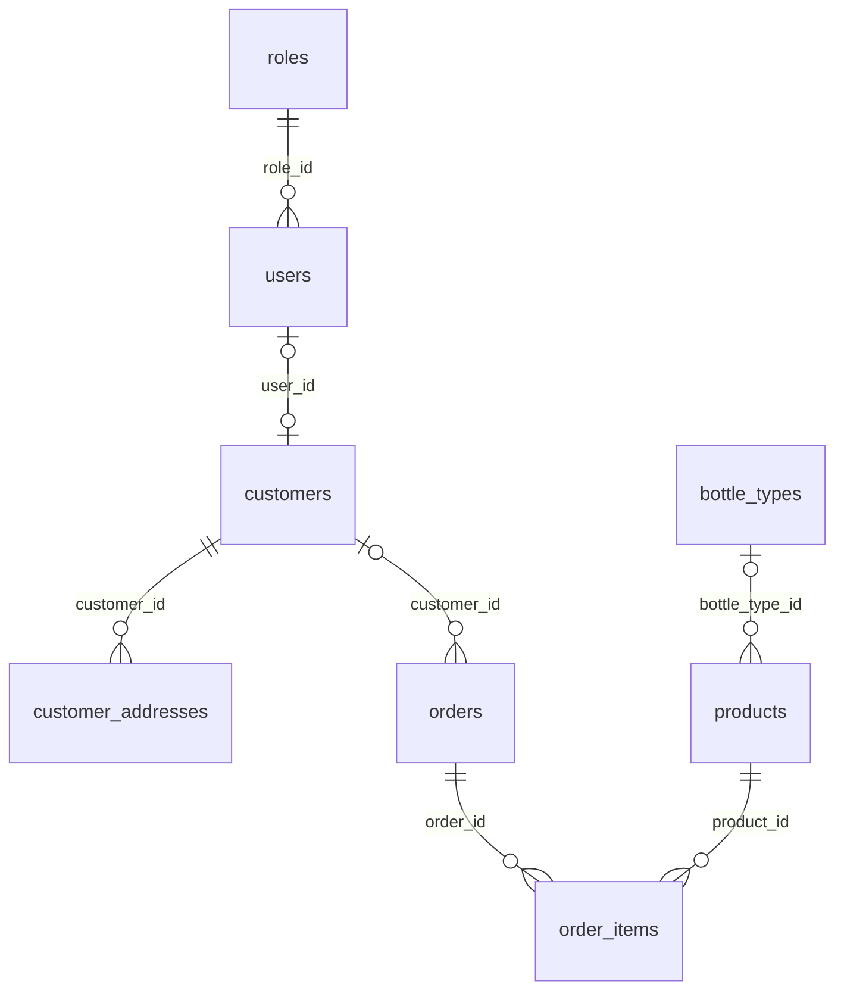

# Sprint 1 API contract snapshot

Nguồn: controller, DTO, SecurityConfig và Flyway tại `develop` sau khi kết nối frontend. Đây là contract triển khai trong repo; cần nhóm xác nhận với ERD/yêu cầu gốc trước khi merge `main`.

Base path: `/api/v1`. JSON request/response. Lỗi dùng `{timestamp,status,error,message,path}`; 400 validation, 401 không đăng nhập, 403 sai quyền, 404 không tìm thấy, 409 xung đột dữ liệu.

| Resource | Đọc | Ghi | Request chính | Response chính |
| --- | --- | --- | --- | --- |
| Auth | `GET /auth/me` với JWT | `POST /auth/login` công khai | `{email,password}` | `{accessToken,tokenType,expiresIn,user}` |
| Product | `GET /products?active=true`, `GET /products/{id}` công khai chỉ với active; ADMIN có thể đọc inactive | `POST /products`, `PUT /products/{id}`, `DELETE /products/{id}`: ADMIN | `sku` (create), `name`, `brand?`, `unit`, `unitsPerCase?`, `bottleTypeId?`, `salePrice` | `id,sku,name,brand,unit,unitsPerCase,bottleTypeId,bottleTypeName,salePrice,active,createdAt` |
| Bottle type | GET công khai | Ghi: ADMIN | `name,depositUnitAmount` | `id,name,depositUnitAmount,active` |
| Supplier | `GET /suppliers`, `GET /suppliers/{id}`: ADMIN hoặc SALES_STAFF | `POST /suppliers`, `PUT /suppliers/{id}`, `DELETE /suppliers/{id}`: ADMIN | `name,phone?,address?` | `id,name,phone,address,active` |
| Customer | `GET /sales/customers`, `GET /sales/customers/{id}`: ADMIN hoặc SALES_STAFF | `POST /sales/customers`, `PUT /sales/customers/{id}`, `DELETE /sales/customers/{id}`: ADMIN hoặc SALES_STAFF | `fullName,phone?` | `id,fullName,phone,createdAt` |
| Customer address | Dưới `/sales/customers/{customerId}/addresses` | CRUD theo `CustomerAddressController` | `recipientName,recipientPhone,addressLine,area?,isDefault?` | Địa chỉ và cờ mặc định |
| Order | `GET /sales/orders`, `GET /sales/orders/{id}`: ADMIN hoặc SALES_STAFF | Chưa có API ghi | — | `OrderResponse` gồm items |

`DELETE` Product/Supplier/Customer là soft delete. Phone khách đang hoạt động là duy nhất khi không null; `+84` được chuẩn hóa về `0`. FE không gửi `stock`, `expiry`, `contactName`, `email`, `type`, `note`, `debt` vào các API danh mục vì API Sprint 1 chưa hỗ trợ các trường đó. Bản dùng thử vận hành độc lập với backend. Phiên thật mở Product/Supplier/Customer, đọc danh sách/chi tiết Order và chuẩn bị phiếu nhập từ danh mục thật. Cửa hàng công khai đọc danh sách/chi tiết Product; các thao tác ghi đơn, nhập kho và dữ liệu tồn/lô vẫn chờ backend. Xem [phạm vi Task 4/5](../frontend/docs/task4-task5-integration.md).

## Database relationship snapshot

Các quan hệ trên suy ra từ V1/V2/V3, chưa phải bản ERD đã được nhóm ký duyệt. `orders.customer_id` và `order_items.product_id` có FK trong PostgreSQL, còn entity JPA giữ scalar ID để tránh phụ thuộc repository xuyên module.

## Kiểm chứng bắt buộc

CI chạy Maven với PostgreSQL service và `DB_URL`; `PersistenceIntegrationTest` khởi tạo context có Flyway/JPA rồi kiểm tra unique phone. Cần chạy thêm E2E trình duyệt với database thật cho login → CRUD → reload, và kiểm nâng cấp V1/V2 khi DB có dữ liệu. Không coi build TypeScript hoặc test mock là bằng chứng FE–BE đã chạy end-to-end.
